# Parv Arora

### Data • Science • Business • Analytics

 

<table align="center" width="860" style="border-collapse: collapse; border: none; margin: 12px auto 0 auto;">
  <tr align="center">
    <td align="center" width="45%" style="border: none; padding: 4px;">
      
    </td>
    <td align="center" width="55%" style="border: none; padding: 4px;">
      
    </td>
  </tr>
</table>

---

## Technical Competencies

  <b>LANGUAGES</b> 
  

  <b>CORE SYSTEMS &amp; DATABASES</b> 
  

  <b>TOOLING &amp; FRAMEWORKS</b> 
  

---

## Featured Systems & Projects

### 01. HEATtoLOAD — India Peak Electricity Demand & Thermal Sensitivity
`Empirical Econometrics · Climate Risk · Energy Telemetry · Production Glassmorphism`

An end-to-end, reproducible empirical investigation quantifying the non-linear relationship between ambient temperature, humidity, and daily peak electricity demand across 16 major Indian states (>85% of national consumption).

- **Grid-India & ERA5 Telemetry:** Pairs 735 consecutive days of official SCADA telemetry with ECMWF ERA5 reanalysis to isolate weather-driven cooling demand.
- **Thermal Sensitivity Modeling:** Discovers a national marginal sensitivity of +2,761.9 MW/°C (+1.62%/°C) with state-level cooling inflection thresholds between 22°C and 27°C.
- **Glassmorphic Cockpit:** Interactive analytics cockpit with real-time scenario simulation, 10/10 verified test suite, and cryptographically hashed claims.

**Tech Stack:** `Python` `DuckDB` `Polars` `ECMWF ERA5` `Grid-India SCADA` `LightGBM` `JavaScript` `CSS Glassmorphism` `Pytest`

  

---

### 02. CRoyaleAI — AI That Plays Clash Royale
`Game AI · Machine Learning · Reinforcement Learning`

An AI agent that learns to play Clash Royale using match replays and simulated games. It chooses which card to play and where to place it without accessing information hidden from the player.

- **Learns from Real Matches:** Uses 14,818 matches and over 3.5 million training records to learn how to play.
- **Makes Its Own Decisions:** Learns which cards to use, when to act, and where to place troops.
- **Tests and Improves Its Strategy:** Trains in a C++ game simulator and predicts troop and projectile movement to help account for input delays.

**Tech Stack:** `Python` `C++` `Spatial Transformer Model` `PPO Reinforcement Learning` `Android Engine Tools`

  

---

### 03. CPU Scheduling Visualiser — Interactive 3D OS Scheduler
`Operating Systems · 3D WebGL · Interactive Simulation`

An interactive 3D ATX motherboard simulation that visualizes how CPU scheduling algorithms—FCFS, SJF, Priority, and Round Robin—dispatch processes from storage to RAM and onto the CPU core, one event at a time.

- **Real-Time 3D Hardware Pipeline:** Procedurally built with React Three Fiber and Three.js; processes travel from the SSD across the board, queue in DDR5 ready-queue slots, and execute on the CPU socket with a live time-slice ring.
- **Pure TypeScript Scheduling Engine:** Simulates preemptive and non-preemptive FCFS, SJF, Priority, and Round Robin algorithms, backed by 104 Vitest unit tests, a synchronized Gantt chart scrubber, and shareable URL state.
- **Algorithm Comparison & Metrics:** Benchmarks all four algorithms side-by-side on the same workload—reporting waiting, turnaround, and response times, CPU utilization, context switches, and CSV export.

**Tech Stack:** `TypeScript` `React 19` `Three.js` `React Three Fiber` `Zustand` `Vite` `Vitest`

  
  

---

### 04. GradeNest — Multi-School Academic Records & Credential Platform
`[Private Project]` • `Full-Stack Development · Multi-Tenant SaaS · Cryptographic Verification`

A multi-tenant school management platform that brings marks entry, maker-checker review, report card generation, certificates, exams, timetables, and fee ledgers into one database-isolated system.

- **Maker-Checker Marks Workflow:** Subject teachers enter marks, class teachers verify or return lists and submit merged class spreadsheets, and administrators generate and release whole-class report card batches.
- **Database-Level Tenant Isolation:** Enforces PostgreSQL Row-Level Security (RLS) on every tenant table, dynamic assignment-based permissions, `httpOnly` cookie sessions with CSRF protection, Keycloak OIDC, and an append-only audit log.
- **Tamper-Evident PDFs & AI Insights:** Renders sealed report cards and certificates via Gotenberg with SHA-256 hashes, QR verification endpoints, versioned corrections, and Gemini-powered teacher remark suggestions across 40+ pages.

**Tech Stack:** `Next.js 16` `React 19` `FastAPI` `Python` `PostgreSQL 16 (RLS)` `Celery` `Redis` `Gotenberg` `Keycloak` `Tailwind CSS` `Gemini` `SHA-256 QR`

---

### 05. Doctor Appointment Scheduling System
`Healthcare · Web Development · Automation`

A doctor appointment system that adjusts the schedule when a procedure runs late and helps patients avoid unnecessary waiting.

- **Adjusts Appointment Times:** Uses procedure durations to update later appointments when delays occur.
- **Sends Text Messages:** Uses Twilio to notify patients about schedule changes.
- **Simple Booking Interface:** Provides a dark-themed web interface for doctors to manage schedules and patients to book appointments.

**Tech Stack:** `Python` `Flask` `HTML` `JavaScript` `SQLite` `Twilio SMS`

  

---

  

<table align="center" width="860">
  <tr align="center">
    <td align="center" width="50%">
      
    </td>
    <td align="center" width="50%">
      
    </td>
  </tr>
  <tr align="center">
    <td align="center" width="50%">
      
    </td>
    <td align="center" width="50%">
      
    </td>
  </tr>
</table>

